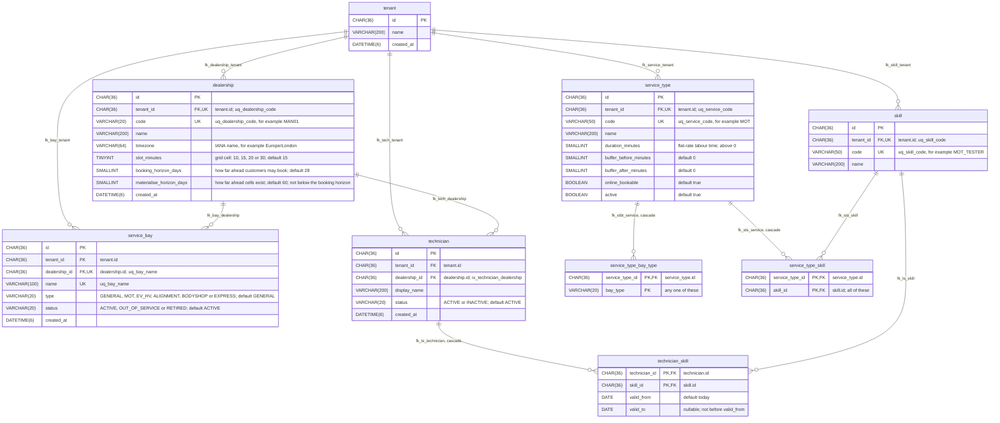
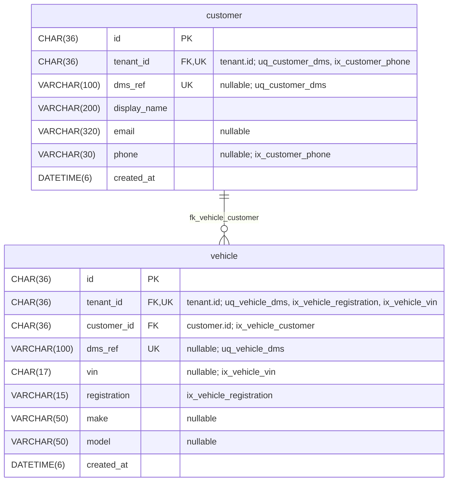
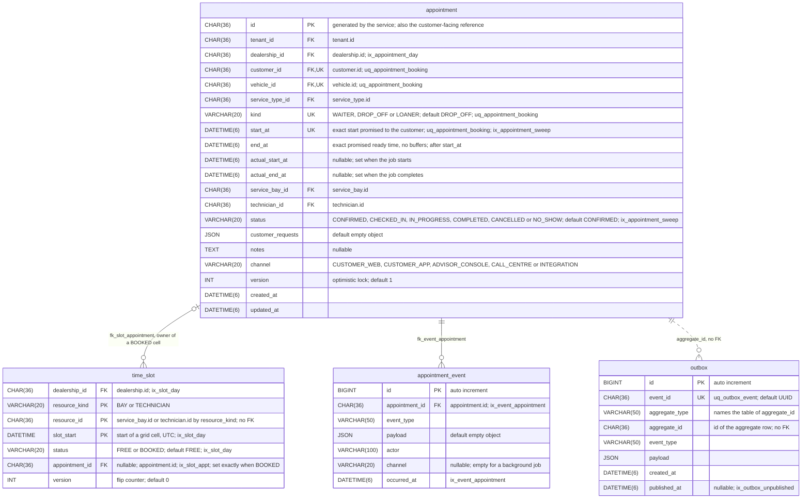
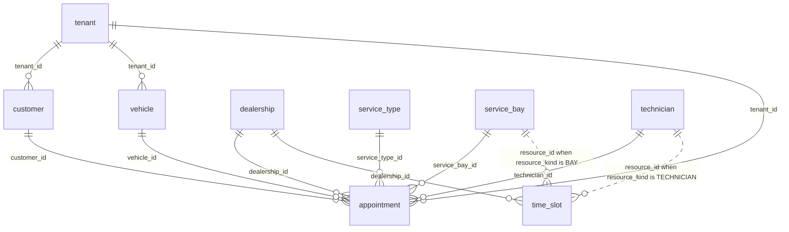

# Data Model

This page describes the database the service runs on: the 15 tables of `local/mysql/schema.sql`,
every column, the keys and indexes, and what each table is for. The schema file is the source;
update this page in the same change that alters it.

MySQL 8.4, InnoDB, `utf8mb4`. Ids are `CHAR(36)` UUIDs. Every instant is a UTC `DATETIME(6)`, and a
ledger cell start is a UTC `DATETIME` on the grid. Enumerations are `VARCHAR(20)` columns, not
`ENUM`; the allowed values of Scheduling's enumerations are Go constants in
`internal/scheduling/enums.go`. There are no stored routines and no triggers. Rows on the booking
path are never deleted: a status change frees capacity and keeps the audit trail.

The tables fall into three groups, one diagram each, followed by the foreign keys that cross
groups. In the diagrams `PK` is a primary key column, `FK` a foreign key column and `UK` a member
of a unique key; the comment names the key or the referenced table. A column the diagram does not
mark as nullable is `NOT NULL`.

## Workshop

The setup data Scheduling reads: tenant, dealerships, bays, technicians, skills and the service
catalogue.

| Table | What it is for |
|---|---|
| `tenant` | The organisation that owns all setup and booking data; every aggregate-root table carries its id |
| `dealership` | One site of a tenant, with its IANA time zone, the length of a grid cell and how far ahead customers may book |
| `service_bay` | A bay at a dealership, with a type that says what it is equipped for and a status; only `ACTIVE` bays are offered to a booking |
| `technician` | A technician at a dealership, with a status; only `ACTIVE` technicians are offered to a booking |
| `skill` | A qualification a tenant defines, identified by a code such as `MOT_TESTER` |
| `technician_skill` | The skills a technician holds and the dates between which each is valid |
| `service_type` | A kind of job: its flat-rate duration, its buffers before and after, and whether customers may book it online |
| `service_type_bay_type` | The bay types that can host a service type; any one of them will do |
| `service_type_skill` | The skills a service type requires; the technician must hold all of them |

## Customers

Snapshots of the dealer management system's customers and vehicles; the dealer system is the
master.

| Table | What it is for |
|---|---|
| `customer` | A customer of a tenant: the name, contact details and dealer-system reference the dealership holds |
| `vehicle` | A customer's vehicle, with its registration, optional VIN, make and model |

## Scheduling

The appointment, the capacity ledger that guards it against double booking, and its audit trail
and outbox.

| Table | What it is for |
|---|---|
| `appointment` | A booking: the exact times promised to the customer, the actual times, the bay and technician, the status and the version that guards every change |
| `time_slot` | The capacity ledger: one row per bay and per technician for every grid cell inside working time, `FREE` or `BOOKED` by one appointment |
| `appointment_event` | The audit trail: one row for the booking and for each transition, with the actor, the channel and a JSON payload |
| `outbox` | An event row written in the same transaction as each booking and transition; `published_at` stays `NULL` because the service never sets it |

## Across the groups

Foreign keys that leave a group, with the two polymorphic references. Entities are shown by name
only; their columns are in the diagrams above.

Two columns point at a row of one of several tables and have no foreign key, so the database does
not check them:

- `time_slot.resource_id` is a `service_bay.id` when `resource_kind` is `BAY` and a
  `technician.id` when it is `TECHNICIAN`. A resource's cells exist only because the fixture
  inserts them.
- `outbox.aggregate_id` is the id of the row of the aggregate that `aggregate_type` names; the
  service writes `Appointment`, so it is an `appointment.id`.

`ON DELETE CASCADE` is set on `technician_skill.technician_id`,
`service_type_bay_type.service_type_id` and `service_type_skill.service_type_id`; every other
foreign key restricts.

## Keys and indexes

Those that carry behaviour:

| Key | Table | Columns | Role |
|---|---|---|---|
| primary key | `time_slot` | `(resource_kind, resource_id, slot_start)` | A cell exists once per resource, so it has one owner at a time. Together with the conditional `UPDATE` that claims a run of cells, it is the double-booking guarantee; within one statement InnoDB takes the row locks in this key's order |
| `uq_appointment_booking` | `appointment` | `(vehicle_id, customer_id, start_at, kind)` | The booking's idempotency key: a vehicle, a customer, a start and a kind identify one appointment, in every status and across dealerships. A duplicate insert is MySQL error 1062 |
| `ix_appointment_sweep` | `appointment` | `(status, start_at)` | The no-show sweeper's query: `CONFIRMED` appointments that started before the cut-off, oldest first |
| `ix_slot_day` | `time_slot` | `(dealership_id, slot_start, status)` | A dealership's cells by time range and status, which the candidate selection and working-time reads filter on |
| `ix_slot_appt` | `time_slot` | `(appointment_id)` | The cells an appointment owns: reading its cell ranges and locking and freeing them on release |

The others:

| Key | Table | Columns |
|---|---|---|
| `uq_dealership_code` | `dealership` | `(tenant_id, code)` |
| `uq_bay_name` | `service_bay` | `(dealership_id, name)` |
| `ix_technician_dealership` | `technician` | `(dealership_id, status)` |
| `uq_skill_code` | `skill` | `(tenant_id, code)` |
| `ix_tech_skill_skill` | `technician_skill` | `(skill_id, technician_id)` |
| `uq_service_code` | `service_type` | `(tenant_id, code)` |
| `uq_customer_dms` | `customer` | `(tenant_id, dms_ref)` |
| `ix_customer_phone` | `customer` | `(tenant_id, phone)` |
| `uq_vehicle_dms` | `vehicle` | `(tenant_id, dms_ref)` |
| `ix_vehicle_registration` | `vehicle` | `(tenant_id, registration)` |
| `ix_vehicle_vin` | `vehicle` | `(tenant_id, vin)` |
| `ix_vehicle_customer` | `vehicle` | `(customer_id)` |
| `ix_appointment_day` | `appointment` | `(dealership_id, start_at)` |
| `ix_appointment_customer` | `appointment` | `(customer_id, start_at)` |
| `ix_appointment_vehicle` | `appointment` | `(vehicle_id, start_at)` |
| `ix_event_appointment` | `appointment_event` | `(appointment_id, occurred_at)` |
| `uq_outbox_event` | `outbox` | `(event_id)` |
| `ix_outbox_unpublished` | `outbox` | `(published_at, id)` |

Checks the schema enforces besides keys:

| Constraint | Table | Rule |
|---|---|---|
| `ck_dealership_slot` | `dealership` | `slot_minutes` is 10, 15, 20 or 30 |
| `ck_dealership_horizons` | `dealership` | `booking_horizon_days` is not above `materialise_horizon_days` |
| `ck_ts_validity` | `technician_skill` | `valid_to` is null or not before `valid_from` |
| `ck_service_duration` | `service_type` | `duration_minutes` is above 0 |
| `ck_appt_order` | `appointment` | `start_at` is before `end_at` |
| `ck_slot_owner` | `time_slot` | a `FREE` cell has no `appointment_id` and a `BOOKED` cell has one |

How the ledger is claimed and released, and how the appointment moves between statuses, is in
[System Architecture](./architecture.md).
