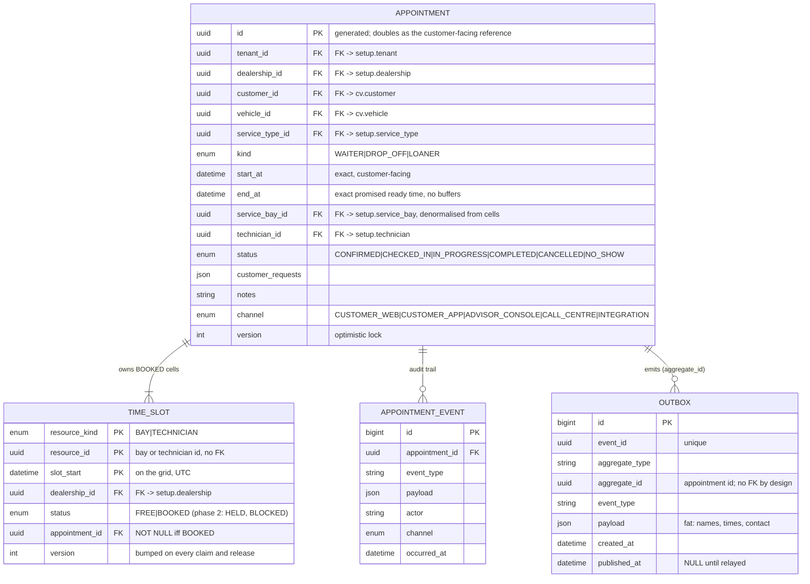
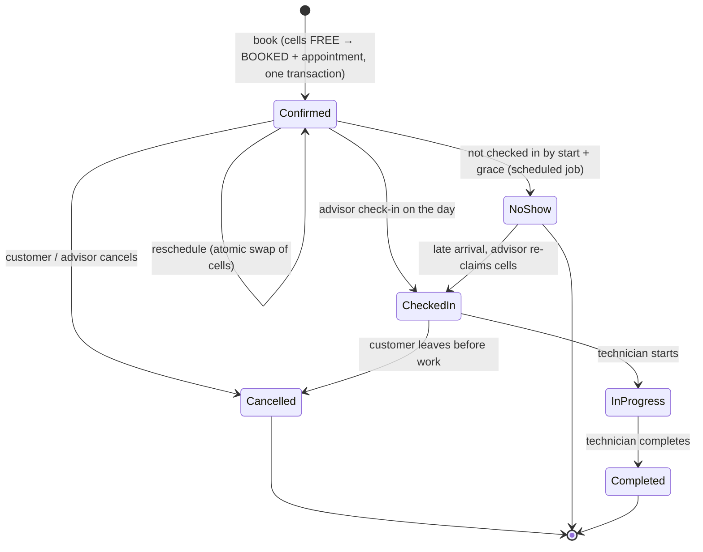
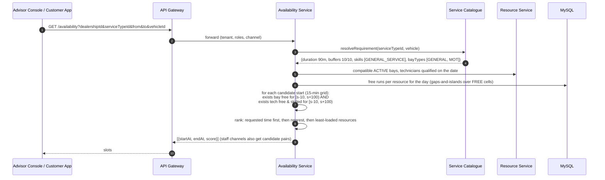

# Scheduling design

This document covers the appointment booking and lifecycle features. Section numbers are stable identifiers that specs cite ("design 5.2"); they are not contiguous, and a reference to a section that is not here points at material outside this release (workshop setup, availability search, the materialiser, rotas, delivery planning). Where the text describes stored procedures (`sp_claim_pair`, `sp_release_cells`) or an `idempotency_key` table, deviations D2 and D4 in `IMPLEMENTATION_NOTES.md` apply: the same statements are issued from Go, and idempotency is the natural booking key on `appointment`.

---

### 1.3 Core requirements restated as acceptance criteria

| # | Requirement | Acceptance criteria |
|---|-------------|---------------------|
| R1 | Resource-constrained booking | A requester can ask for `(vehicle, service type, dealership, desired time)` and get either a confirmed appointment, an alternative set of slots, or a clear rejection. |
| R2 | Real-time availability check | No appointment is confirmed unless **one ServiceBay** of the required type **and one Technician** with the required skills are free for `[start, start + duration)` including buffers. Two concurrent requests can never both get the same bay or technician for overlapping windows. |
| R3 | Confirmed appointment record | On success a persistent `Appointment` exists linking customer, vehicle, dealership, service type, technician, service bay, and the time window, with an audit trail and a stable reference number. |

### 1.4 Scope of v1

v1 delivers the three core requirements on a deliberately small surface. Everything that would make the workshop model richer has been pushed out so that the booking core can be built, tested and explained end to end. The rule for what stayed in: it is needed to confirm a correct booking or to keep the ledger truthful.

**In scope**

| Area | v1 behaviour |
|---|---|
| Resources | Dealerships with opening hours and exceptions; bays with a type and status; technicians with skills that have validity dates |
| Capacity ledger | One `time_slot` row per bay and per technician per 15-minute cell inside the resource's working intervals (its rota, or the opening hours when it has none), materialised ahead over a horizon |
| Availability | Grid start times where some compatible bay and some qualified technician each have a free run of the required cells, computed per day straight from MySQL |
| Booking | One transaction for every channel: insert the appointment, claim its cells through `sp_claim_pair`, commit. Confirmed appointment with customer, vehicle, one service type, bay, technician and exact times |
| Lifecycle | Book, reschedule, cancel, check-in, start, complete, no-show |
| Plumbing | Natural-key idempotency, append-only appointment events, transactional outbox, confirmation notification, DMS booking sync via events |
| Channels | Customer web/app, advisor console, call centre, integration. All see the same availability and can book any free cell |

**Out of scope for v1**

| Excluded | Why excluded | What v1 does instead | Where it plugs in later |
|---|---|---|---|
| Time-boxed holds (reserve a slot for a few minutes while the customer finishes the form) | Adds a second lifecycle, a sweeper and capacity parked behind abandoned sessions | The claim happens at confirm; if the slot went, the customer sees alternatives immediately | `HELD` cell state with `expires_at`, a `hold` owner record and a sweeper; 5.2 |
| Shift patterns with multi-week cycles, per-date rota overrides, HR import | A rota engine is its own product; the brief does not require it | A weekly rota per bay and technician with a validity range feeds the materialiser (4.1.2, 11.5). A resource with no rota works the opening hours; an exceptional day is handled by the controller | Pattern and override tables resolved into the same working intervals; 11.5 |
| Technician absences (sick, holiday, training) | Needs a `BLOCKED` cell state, an owner record and a controller worklist | Controller rebooks the technician's appointments by hand and the remaining cells stay bookable until the day passes | `BLOCKED` status with reason; 11.5, 5.5 |
| Capacity blocks (lunch, lift maintenance, internal work, carryover) | Same mechanism as absences, applied to any resource or the whole site | Controller books a placeholder appointment if they must keep time free | Same as absences; 11.5 |
| Channel reservations ("who can book what", walk-in reserve, web vs shop capacity) | A policy layer on top of the ledger | Everyone can book every free cell | `reserved_for` on the cell and a channel parameter on the claim; 11.5 |
| Per-service daily caps (six MOTs a day) | A second capacity dimension beyond cells | Not enforced | Cap table checked in availability and at claim; 11.5 |
| Reallocation when a technician drops out, at-risk flags, reassign | Depends on absences existing | Controller reschedules by hand through the normal flow, same cells on another technician | Reassign is a reschedule where only the technician changes; 5.5 |
| Overrun detection and flagging | Needs actual clocking data from the DMS | Technician completes late; next appointment is handled by the advisor | Compare actual end with next `BOOKED` cell; 2.5 |
| Waiter versus drop-off rules (waiter only for short jobs, drop-off work floats within the day) | Market practice, but a policy on top of the ledger | `appointment.kind` is recorded; nothing is enforced; technician cells start at arrival | A `waiter_allowed` flag on `service_type`; availability filters by kind; drop-off places technician cells later; 12 |
| Multi-service appointments (MOT + interim service as one booking) and per-model duration overrides | Needs appointment line items and a catalogue override table; the ledger itself does not care | One service type per appointment. A combination that is sold together is its own catalogue entry (`MOT_PLUS_INTERIM`) with the summed duration, the union of skills and the intersection of bay types | `appointment_service` line table and `service_type_vehicle_override`; the claim takes the summed cell count unchanged; 2.3 A4 |
| Courtesy cars, collection and delivery, loaners as bookable resources | Day-granular resources need their own ledger | Captured as free-text customer requests on the appointment | Separate resource kind or table; phase 3 |
| Multi-dealership search ("soonest anywhere near me") | Fan-out and ranking across sites | One dealership per availability request | Same per-day query across sites; phase 3 |
| Availability read model (Redis cache, bitmaps) | Not needed at the agreed scale on one node | Day and week views query `time_slot` directly | Per-dealership-day projector, invalidated by events; Section 7 |
| Reminders, confirm/reschedule links, no-show chasing | Notification product work, not booking correctness | Confirmation message only | Notification Service consumes existing events; phase 2 |
| Planning board, utilisation reporting | UI on top of the ledger | Advisor console day list only | `COUNT(BOOKED)/COUNT(*)` on `time_slot`; phase 2 |
| OEM recall suggestions, parts pre-pick, actual-versus-standard duration learning | Integrations and analytics | Not present | Consume `AppointmentConfirmed` / `AppointmentCompleted`; phase 3 |
| Changing the grid size after go-live | Full regeneration | `slot_minutes` is set at deployment | Migration procedure |

Each exclusion changes which cells exist, which cells a caller may claim, or what happens around a booking. None of them changes `sp_claim_pair` or the appointment record, which is the point of settling the ledger first.

---

## 4. Domain model (scheduling group only)

### 4.1 Entity relationship diagrams

The v1 model is one MySQL schema of 18 tables, served by one application. The model is split into three groups (Workshop Setup, Customer & Vehicle, Scheduling) purely so each picture fits on a screen; only the Scheduling group is reproduced here. The grouping follows the bounded contexts, but nothing here implies separate services, schemas or databases: every relationship drawn is a real foreign key in `schema.sql`, including the ones that cross a group.

Conventions used in all four diagrams:

- Solid lines are foreign keys whose both ends are in the same group.
- Dashed lines are references by id with no foreign key. They occur only where a `resource_id` column points at either a bay or a technician depending on `resource_kind`.
- An attribute comment `FK -> group.table` marks a foreign key whose target is drawn in a different group. The overview diagram shows those cross-group lines once so the detail diagrams can leave them out.
- Attribute lists are complete except for `created_at` and `updated_at` timestamps.

#### 4.1.4 Scheduling

The booking transaction and everything it writes: the appointment, the capacity ledger, the audit trail and the outbox. This is the only group written on the customer path.



One relationship in this group is deliberately not a foreign key. `outbox.aggregate_id` is kept free of constraints so the relay can purge published rows without touching the appointment, and so the same table can later carry events for other aggregates. `appointment.id` is generated by the Booking Service and doubles as the customer-facing reference; there is no separate reference column. Idempotency is the natural booking key: the unique index on `(vehicle_id, customer_id, start_at, kind)` means two identical requests, whether a retry or a concurrent double submit, can only ever produce one appointment. The key covers every status, so rebooking the exact same minute after a cancellation returns the cancelled appointment with `409 DUPLICATE_BOOKING` rather than creating a second row.

### 4.2 Key modelling decisions

- **`TIME_SLOT` is the heart of R2.** Capacity is a ledger with one row per bay and per technician for every 15-minute cell inside their working time. A booking claims a run of consecutive cells on one bay and one technician. The row's primary key `(resource_kind, resource_id, slot_start)` is the uniqueness guarantee, and a cell that does not exist is time the resource does not work. This is the model the market uses: every vendor and dealer site offers arrival times on a 15 to 30 minute grid.

  ```sql
  -- the claim, per resource, inside sp_claim_pair
  UPDATE time_slot
     SET status = 'BOOKED', appointment_id = :appointment_id, version = version + 1
   WHERE resource_kind = 'BAY' AND resource_id = :bay_id
     AND slot_start BETWEEN :first_cell AND :last_cell
     AND status = 'FREE';
  -- ROW_COUNT() must equal the cells needed; if not, a locking COUNT of the
  -- cells in the range tells BAY_NOT_OPEN apart from SLOT_TAKEN
  ```

  An `UPDATE` is a current read in InnoDB: it locks each matching row and evaluates `status = 'FREE'` against the latest committed version regardless of the transaction's snapshot. Two claimers for overlapping cells serialise on the first shared row; the loser updates fewer rows and fails the count. No explicit locks and no isolation-level dependency. The procedure is the only write path so no caller can skip the count. Section 11.3 has the full reasoning and the validation results.

- **The appointment keeps exact times; only the ledger is quantised.** `appointment.start_at/end_at` are the minutes promised to the customer. A 78-minute job occupies six cells (90 minutes) in the ledger. This keeps the audit record truthful and makes a later change of grid, or of model, a regeneration of the ledger rather than a loss of information.

- **Bay and technician cells are claimed independently.** The procedure takes a separate first cell and cell count for each. For a waiter appointment both start at arrival. For a drop-off the technician's cells can start later in the day, which is how the market's "arrival time is not work-start time" practice fits the brief's requirement that both resources are reserved for the full duration.

- **Rotas generate the cells, and every cell is bookable.** Each active bay and technician gets cells for its working intervals over the horizon: its weekly rota rows clipped to the opening hours, or the opening hours alone when it has no rota (4.1.2). Absences, blocks and channel rules are out of scope for v1, so any caller may claim any `FREE` cell. Each of those later features changes only which cells exist or which are claimable; the ledger and the claim stay the same.

- **Buffers live in the ledger, not the appointment.** A 10-minute vehicle-move buffer rounds up to one extra cell on the bay. A technician-only road-test buffer makes the technician's run longer than the bay's. Both are just different cell counts.

- **Skills have validity dates.** MOT tester status and EV certifications expire. Availability checks `valid_to >= appointment date`.

- **Appointment carries a `version`** for optimistic locking on edits that don't touch the ledger.

### 4.3 Appointment state machine



Transitions change the ledger as follows:

| Transition | Ledger effect |
|-----------|-------------------|
| `book` | Insert `Appointment`, then `sp_claim_pair` sets the bay cells and technician cells `FREE → BOOKED` with `appointment_id`. `SLOT_TAKEN` if any cell is not free → retry with the next candidate pair. One transaction. |
| `reschedule` | In one transaction: claim the new cells via `sp_claim_pair` (cells already owned by this appointment count as claimable), then set the old cells `FREE`. If the claim fails, nothing changes. |
| `cancel` / `noShow` | `sp_release_cells` sets every cell `BOOKED → FREE`. Cancel releases immediately. No-show is applied by a Booking Service job that runs every minute, marks appointments past `start_at + grace` and emits `AppointmentNoShow`; the grace period and whether release is automatic are open question 2, default 30 minutes and yes. |
| `noShow → checkedIn` (late arrival) | A reschedule into whatever run is free now, same transaction as the check-in: `sp_claim_pair` for the new cells, then `sp_release_cells`. If nothing is free the advisor books a fresh appointment instead. |
| `complete` | `sp_release_cells` with `keep_before` set to the current grid cell, so cells from now onwards go `BOOKED → FREE` and an early finish is bookable by a walk-in. Cells already in the past stay `BOOKED`. Utilisation reporting uses the appointment's actual start and end, not the ledger. |

---

## 5. Core interactions

> 5.1 is reproduced because booking selects candidate (bay, technician) pairs with the same query. There is no public availability endpoint in this release.

### 5.1 Availability search (R2 read side)



Customer channels receive start times only. The candidate `(bay, technician)` pairs are internal: the Booking Service recomputes them at confirm and `POST /appointments` does not accept them, so there is nothing for a client to replay or tamper with. Staff channels may receive them for the planning board.

Algorithm for one day at one dealership, run directly against MySQL (the whole day's cells for a dealership are a few hundred rows):

```
requirement = catalogue.resolve(serviceType, vehicle)   -- duration, buffers, bay types, skills
cells_bay   = ceil((bufferBefore + duration + bufferAfter) / slot_minutes)
cells_tech  = ceil((bufferBefore + duration + techBufferAfter) / slot_minutes)

bays  = compatible ACTIVE bays;  techs = ACTIVE technicians holding all required skills on that date

-- one query: runs of consecutive FREE cells per resource (gaps-and-islands)
islands = SELECT resource_kind, resource_id, MIN(slot_start) AS s, MAX(slot_start) AS e
          FROM (SELECT ..., slot_start - INTERVAL slot_minutes * ROW_NUMBER() OVER (PARTITION BY kind, id ORDER BY slot_start) MINUTE AS k
                FROM time_slot WHERE dealership_id = ? AND status = 'FREE' AND slot_start in day)
          GROUP BY kind, id, k

for each candidate start c on the grid inside opening hours:
    bay_ok  = ∃ b ∈ bays  : some island of b contains [c - bufferBefore, c - bufferBefore + cells_bay)
    tech_ok = ∃ t ∈ techs : some island of t contains [c - bufferBefore, c - bufferBefore + cells_tech)
    if bay_ok and tech_ok: emit c

rank by |c - desired|, then prefer starts that leave larger free islands behind
```

The run check is done **per resource and then OR-ed across resources**. Bay 1 free 09:00 to 09:15 and Bay 2 free 09:15 to 09:30 do not make a 30-minute slot at 09:00, because neither bay individually contains the run. That exact case is a named unit test. The AND across kinds is valid because a bay and a technician are chosen independently; if a rule ever couples them (a technician who may only use a home bay) the check must be done over pairs.

Load: a week view scans roughly 18 resources × 40 cells × 7 days ≈ 5,000 rows through `ix_slot_day`, which a single MySQL node serves comfortably at dealer-group scale. A per-dealership-day cache (Section 7) is an optional later step if measured load requires it, not part of the baseline.

### 5.2 Book (R2 write side, R3)

v1 has no time-boxed hold. A booking request claims its cells and creates the appointment in one transaction. If the cells have gone, the caller gets alternatives and the customer picks again.

```mermaid
sequenceDiagram
    autonumber
    participant UI as Client
    participant BK as Booking Service
    participant SC as Catalogue
    participant DB as MySQL
    participant OB as Outbox relay
    participant BUS as Event bus
    participant NT as Notifications
    participant DMS as DMS adapter

    UI->>BK: POST /appointments {dealership, serviceType, vehicle, customer, startAt, kind, requests}
    BK->>SC: resolveRequirement → cells_bay, cells_tech, bay types, skills
    BK->>DB: candidate (bay, tech) pairs with free runs at startAt (same query as availability),<br/>ordered least-loaded first, ties shuffled per request
    loop until success or candidates exhausted
        BK->>DB: START TRANSACTION;<br/>INSERT appointment (generated id, CONFIRMED, bay, technician, exact times)  ← duplicate on (vehicle, customer, start, kind): see below;<br/>CALL sp_claim_pair(bay, firstCell, cells_bay, tech, firstCell, cells_tech, appointmentId)<br/>  → UPDATE bay cells FREE→BOOKED, ROW_COUNT must = cells_bay<br/>  → UPDATE tech cells FREE→BOOKED, ROW_COUNT must = cells_tech;<br/>INSERT appointment_event; INSERT outbox(AppointmentConfirmed); COMMIT
        alt SQLSTATE 45001 SLOT_TAKEN
            DB-->>BK: ROLLBACK → try next pair
        else 45002/45004 technician cells / bay cells do not exist
            DB-->>BK: ROLLBACK → candidate list is stale, recompute availability, retry once
        else MySQL 1213 deadlock victim (reschedule racing on the same cells)
            DB-->>BK: ROLLBACK → retry the same pair once
        else MySQL 1062 on uq_appointment_booking (an appointment for this vehicle, customer, start and kind exists)
            DB-->>BK: ROLLBACK → return the existing appointment (same request) or 409 DUPLICATE_BOOKING
        end
    end
    BK-->>UI: 201 {id, bay, technician, startAt, endAt}<br/>or 409 SLOT_TAKEN {alternatives[]}

    OB->>BUS: publish AppointmentConfirmed
    BUS->>NT: send confirmation email/SMS
    BUS->>DMS: create provisional booking / RO shell
```

Guarantees:

- **No double booking** even with many instances and no distributed lock: each cell is one primary-key row, the claim is an `UPDATE ... WHERE status = 'FREE'`, and the row count is checked. Two claimers for the same cell serialise on that row's lock, and the loser's update matches fewer rows.
- **No booking outside working time**: cells exist only inside opening hours. Missing cells make the count fall short before anything is written.
- **Idempotent**: the appointment row is inserted as the first statement of each booking attempt, and its unique key on vehicle, customer, start time and kind is the idempotency guard. A concurrent retry blocks on that index until the first attempt commits (then it finds the existing appointment and returns it) or rolls back (then it proceeds). Two appointments for one vehicle, customer, start and kind are impossible, and the client sends no idempotency header. A retry of a request that failed finds no row and simply runs again.
- **Atomic record + events**: the appointment, its cells, its audit event and the outbox row commit together, so downstream systems eventually see every confirmation exactly once (consumers dedupe on event id).

**Why no hold in v1.** A hold protects a self-service customer who takes minutes between picking a time and pressing confirm. It costs a second lifecycle (held, expired, released), a sweeper job, and capacity sitting behind abandoned sessions. v1 accepts the occasional "that slot just went, here are the alternatives" at confirm time in exchange for a single booking transaction. The hold can be added later as a `HELD` cell state with an expiry, without changing the claim.

### 5.3 Concurrency scenario: two customers, one slot

1. Alice and Bob both see "Tue 09:00" as available (both legitimately true at read time).
2. Both call `POST /appointments` within the same second. Candidate pairs are ordered least-loaded first with a per-request shuffle among ties, so two simultaneous requests usually try different pairs and both succeed without ever contending. For this scenario assume the load is equal and both happen to pick `(Bay 2, Tech Sam)`.
3. Both transactions insert their appointment row and call `sp_claim_pair`. Alice's `UPDATE` on Bay 2's four cells acquires the row locks first and sets them `BOOKED`. Bob's `UPDATE` blocks on the first of those rows. Alice's technician update succeeds, she commits. Bob's update resumes, re-reads the rows as `BOOKED`, matches zero of them, and the procedure raises `SLOT_TAKEN`.
4. Bob's Booking Service rolls back (his appointment row goes with it), catches the error and retries with the next pair `(Bay 3, Tech Priya)`. If that works, Bob also gets 09:00 (different resources). If no pair remains, Bob receives `409 SLOT_TAKEN` with the nearest alternatives in the body, and the UI updates the calendar.
5. Neither customer ever receives a confirmation that later turns out to be false.

### 5.4 Reschedule (atomic swap)

Within one transaction: call `sp_claim_pair` for the new cells with the appointment's own id as the exclusion, so cells it already owns count as claimable → success means every other cell was free → call `sp_release_cells` with the new runs as the cells to keep, which frees everything else the appointment owns → update appointment times, bay and technician with the optimistic version check (zero rows matched means a concurrent edit; roll back) → event `AppointmentRescheduled`. The kept runs are matched on resource id as well as kind and time, so a reassign to another technician in the same window frees the old technician's cells. If the claim fails, the transaction rolls back and the customer keeps the original booking. The UI shows "that slot was just taken, here are alternatives."

A reschedule can be chosen as a deadlock victim when a booking races it for the cells it is about to free (11.3). The Booking Service retries it once, exactly like `SLOT_TAKEN`.

### 5.6 Day-of flow

`Confirmed → CheckedIn` (advisor) → DMS Repair Order opened → `InProgress` (technician clocks on) → `Completed` (clocks off, actual duration recorded) → remaining cells released → if job overran, next allocations on that bay/technician are flagged to the controller.

---

## 6. API surface (v1)

All endpoints are tenant- and dealership-scoped via auth context. Times are ISO-8601 with offset; stored UTC.

| Method & path | Who | Purpose |
|---------------|-----|---------|
| `GET /dealerships/{id}/availability?serviceTypeId&vehicleId&from&to&prefs` | customer, advisor | Feasible slots with ranking and candidate pairs |
| `POST /appointments` | customer, advisor, integration | Book: claim cells and create the appointment in one transaction |
| `GET /appointments/{id}` | owner, staff | Full record including allocations |
| `POST /appointments/{id}/reschedule` | owner, staff | Atomic move |
| `POST /appointments/{id}/cancel` | owner, staff | Release |
| `POST /appointments/{id}/check-in` `/start` `/complete` `/no-show` | staff | Day-of transitions |
| `GET /dealerships/{id}/schedule?date` | controller, technician | Planning board / day list projection |
| `CRUD /dealerships/{id}/bays`, `/technicians`, `/technicians/{id}/skills`, `/opening-hours` | admin | Resource management |
| `CRUD /service-types` | admin | Catalogue |

Error contract (examples):

| HTTP | code | Meaning |
|------|------|---------|
| 409 | `SLOT_TAKEN` | Resources no longer free; body includes `alternatives[]` |
| 409 | `AVAILABILITY_CHANGED` | Cells disappeared between search and claim (internal `TECHNICIAN_NOT_WORKING` / `BAY_NOT_OPEN`); body includes freshly computed `alternatives[]` |
| 422 | `NO_QUALIFIED_TECHNICIAN` | No technician at this site holds the required skills at all (configuration problem, not a timing problem) |
| 422 | `OUTSIDE_OPENING_HOURS` | Requested window not within dealership hours |
| 422 | `OFF_GRID_START` | Requested start is not on the dealership's booking grid |
| 422 | `SERVICE_NOT_BOOKABLE_ONLINE` | Customer channel asked for a staff-only service type |
| 409 | `DUPLICATE_BOOKING` | An appointment already exists for this vehicle, customer, start time and kind, in any status, and the rest of the request differs or the existing one is cancelled. The existing appointment is returned in the body |

Domain events published: `AppointmentConfirmed`, `AppointmentRescheduled`, `AppointmentCancelled`, `AppointmentCheckedIn`, `AppointmentStarted`, `AppointmentCompleted`, `AppointmentNoShow`, `ResourceChanged`.

---

## 7. Cross-cutting concerns

| Concern | Approach |
|---------|----------|
| **Consistency** | Writes and reads on a single MySQL node. The claim is an `UPDATE` on primary-key cell rows with a row-count check, correct at any isolation level. A reschedule racing a booking on the same cells can be a deadlock victim (MySQL 1213) and is retried; the ledger is never left inconsistent (11.3). Availability reads the same table; a replica and a per-dealership-day cache are optional later steps. Never accept a false confirmation. |
| **Idempotency** | Natural key, no header. A booking is identified by vehicle, customer, start time and kind, and a unique index over those columns allows one appointment per key. The appointment `INSERT` is the first statement of the write transaction, so a concurrent retry waits on the index and then finds the committed row; a retry can never create a second appointment (5.2). The key covers every status; rebooking the same minute after a cancellation is a `409 DUPLICATE_BOOKING`, and the customer picks another time. |
| **Time zones & DST** | Store `DATETIME(6)` in UTC with `time_zone = '+00:00'` on every connection; dealership timezone used to render and to expand opening hours/shifts. Test the DST change days explicitly (a 02:00 slot that doesn't exist). |
| **Multi-tenancy** | `tenant_id` on every aggregate-root table (dealership, bay, technician, skill, service type, customer, vehicle, appointment); child and ledger rows are reached only through their parent. Mandatory filter in the repository layer, verified by tests (MySQL has no row-level security). Dealer-group users can span dealerships within their tenant only. |
| **AuthZ** | Customers can only read/modify their own appointments. Staff roles scoped to dealership(s). Integration clients use client-credentials with explicit scopes. |
| **Auditability** | `appointment_event` append-only log with actor and channel; required for disputes ("you told me 9am"). |
| **Observability** | Metrics: availability latency p95, `SLOT_TAKEN` rate at confirm, utilisation per bay/technician, no-show rate. Tracing across gateway → booking → DB. Alerts on outbox lag. |
| **Resilience** | DMS down must not block booking: booking confirms locally, DMS sync retries from the outbox. Notification provider down: retries with backoff; appointment remains valid. |
| **Performance targets** | Availability search for one dealership-week < 300 ms p95 (about 5,000 cell rows through `ix_slot_day`); book < 200 ms p95; both at 50 req/s initially on one node. |
| **Data protection** | Customer PII minimised in the scheduler (snapshot fields only); GDPR erasure handled by referencing DMS ids and anonymising snapshots. |
| **Testing** | Property-based tests on the interval algebra; concurrency tests that fire N parallel bookings at one slot and assert exactly the available number succeed; a reschedule-versus-book race on the same cells that must end with one retry and a consistent ledger; reassign to another technician frees the old one; contract tests for DMS adapter; DST and leap-year fixtures. |

---

## 11. Database schema notes

### 11.1 Schema design notes

- **Capacity is a ledger of cells.** `time_slot` has one row per bay and per technician per 15-minute cell (`dealership.slot_minutes`) inside working time. Primary key `(resource_kind, resource_id, slot_start)`. A missing row is time the resource does not work. `FREE` and `BOOKED` are the only states; every `FREE` cell is bookable by anyone.
- **The claim is an `UPDATE` with a row-count check**, in `sp_claim_pair`, the only sanctioned way to take capacity; `sp_release_cells` is the only way to give it back. The claim runs the `UPDATE` first and counts existing cells only when it falls short, so the happy path is two statements. No `FOR UPDATE`, no isolation-level requirement. Section 11.3 explains why that is enough, the one MySQL gotcha it has, and the one deadlock it can be party to.
- **The grid is anchored to the UTC clock.** A cell starts at a whole multiple of `slot_minutes` from the top of the hour; the materialiser and the claim both reject anything else (`45003 OFF_GRID_START`). Opening times must sit on the grid. That holds for every whole-hour and half-hour timezone offset with 10, 15 and 30 minute cells; a 20-minute cell in a half-hour-offset zone is the one combination it excludes.
- **The appointment id is the reference.** The Booking Service generates a UUID, inserts it, and returns it as the customer-facing reference. A human-readable per-dealership format is deferred and would be an additional column, not a change to the id.
- **Idempotency is a unique key**, `uq_appointment_booking` on `(vehicle_id, customer_id, start_at, kind)`. Its only job is that two identical requests produce one appointment. It covers every status, so the same minute cannot be rebooked after a cancellation; the client gets `409 DUPLICATE_BOOKING` and picks another time.
- **The appointment keeps exact minutes.** `appointment.start_at/end_at` are what was promised. The ledger rounds up to whole cells. The appointment also denormalises `service_bay_id` and `technician_id` so R3's record is self-contained.
- **Bay and technician runs are independent.** `sp_claim_pair` takes a first cell and a cell count for each, so buffers can differ and a drop-off's technician work can start later than arrival.
- **Rotas and opening hours generate the cells** for every bay and technician via `sp_materialise_resource_day` over `materialise_horizon_days`, one call per working interval. Absences and blocks are out of scope; see 11.5 for the plug-in points.
- **Instants are `DATETIME(6)` in UTC**, cells are `DATETIME` on the grid. The application runs `SET time_zone = '+00:00'` on every connection and applies `dealership.timezone` only when expanding local-time opening hours into cells, and when rendering.
- **Index for availability** is `(dealership_id, slot_start, status)`, which serves "all free cells for this dealership on this day" in one range scan. The primary key serves the claim.
- **Nothing on the booking path is deleted.** Status changes free capacity; `appointment_event` is the audit trail.
- **The outbox** lives in the same database so it commits atomically with the business rows.
- **Tenant isolation** is a `tenant_id` column on every aggregate-root table enforced by a mandatory repository filter. Child and ledger tables (opening hours, technician skills, `time_slot`, events) are reached only through their parent and carry the parent key instead.

### 11.3 What `sp_claim_pair` guarantees, and why an UPDATE is enough

| Checked inside the procedure | Deliberately left to the Availability Service |
|---|---|
| Both first cells sit on the grid (`45003 OFF_GRID_START`) | Ranking, alternatives, load balancing |
| Every cell in the bay run exists (`45004 BAY_NOT_OPEN`) | Bay type matches the service type |
| Every cell in the technician run exists (`45002 TECHNICIAN_NOT_WORKING`) | Technician holds every required skill, valid on the date |
| Every cell in both runs was `FREE` and is now claimed (`45001 SLOT_TAKEN`) | |

**Why the `UPDATE` is race-free without explicit locks.** In InnoDB an `UPDATE` is a *current read*: for each row it matches it takes an exclusive row lock and evaluates the `WHERE` clause against the latest committed version, not against the transaction's snapshot. Two transactions claiming overlapping cells therefore serialise on the first shared row. When the loser resumes, that row is no longer `FREE`, it matches fewer rows, and `ROW_COUNT()` falls short. The interval model needed a parent-row lock, a lookup-lock-verify sequence and a `READ COMMITTED` requirement to get the same guarantee. The validation deliberately runs at MySQL's default `REPEATABLE READ`.

**Claim first, diagnose on failure.** The procedure runs the claiming `UPDATE` straight away and only when `ROW_COUNT()` falls short does it count the cells that exist in the range, with a locking read so that it sees the current state rather than the transaction's snapshot. A missing cell is `BAY_NOT_OPEN` / `TECHNICIAN_NOT_WORKING`; a present but taken cell is `SLOT_TAKEN`. The happy path is two statements.

**Why plain claims cannot deadlock each other.** Within one `UPDATE`, InnoDB locks rows in primary-key order, so every claimer on the same resource acquires `(kind, id, 08:00)` before `(kind, id, 08:15)`. Across resources every caller claims the bay before the technician. Consistent order in both dimensions.

**The one deadlock that can happen, and why it is harmless.** A reschedule claims its new cells and then frees its old ones through `ix_slot_appt`, which is not primary-key order. Under `REPEATABLE READ` a losing claim keeps exclusive locks on the `BOOKED` rows it scanned until it rolls back. So a booking that overlaps both the old and the new run of a reschedule can hold the old cells while waiting for the new ones, and the reschedule then waits on the old cells: a cycle. InnoDB detects it immediately and rolls one side back with error 1213. The Booking Service treats 1213 exactly like `SLOT_TAKEN` and retries once. The validation reproduces this case on purpose: the reschedule was the victim, the booking then correctly got `SLOT_TAKEN`, and the appointment kept its original eight cells. `READ COMMITTED` would narrow the window, because it releases locks on non-matching rows, but the design does not depend on it.

**The one gotcha: `ROW_COUNT()` counts changed rows, not matched rows.** The first validation run of the reschedule case failed with `SLOT_TAKEN`. Re-claiming two cells the appointment already owned set identical values, MySQL reported them as unchanged, and the count came up two short. `version = version + 1` in the `SET` clause forces every matched row to change. Alternatively the connection flag `CLIENT_FOUND_ROWS` changes the semantics, but a schema-level fix does not depend on every client being configured.

**Lock scope.** Only the cells being claimed are locked, for the few milliseconds of the transaction. Validated: a transaction holding Sam's 10:00 to 11:00 cells open for four seconds did not delay a booking of Sam's 15:00 to 16:00 cells, and a booking of 10:30 to 11:30 waited three seconds and then correctly got `SLOT_TAKEN`.

**Error handling in the Booking Service.**

| SQLSTATE | Meaning | Caller's reaction |
|---|---|---|
| `45001 SLOT_TAKEN` | Someone else got a cell in the run | Roll back, try the next candidate pair; none left → `409 SLOT_TAKEN` with alternatives |
| `45002 TECHNICIAN_NOT_WORKING` | Technician cells do not exist for that time: not yet materialised, retired, or candidate list stale | Roll back, recompute availability, retry once |
| `45004 BAY_NOT_OPEN` | Bay cells do not exist: opening hours changed or bay out of service | Same |
| `45003 OFF_GRID_START` | A first cell is not on the dealership grid | Caller bug: `422 OFF_GRID_START`, no retry |
| MySQL `1213` deadlock victim | This transaction lost a reschedule-versus-book race | Roll back, retry the same operation once |

Validated on MySQL 8.4 with `scripts/mysql_concurrency_test.sh`:

| Scenario | Result |
|----------|--------|
| Materialisation from opening hours, 5 resource-days | 200 cells |
| 20 parallel bookings, same pair, same hour | 1 booked, 19 `SLOT_TAKEN`, exactly 8 `BOOKED` cells, 1 appointment row |
| Back-to-back hour on the same pair | claimed |
| Same window, different pair | claimed |
| Bay free, technician busy | `SLOT_TAKEN` |
| Bay materialised, technician not yet materialised for that day | `TECHNICIAN_NOT_WORKING` |
| Window runs past closing | `BAY_NOT_OPEN` |
| Technician working, bay not yet open | `BAY_NOT_OPEN` |
| 78-minute job | claimed as 6 cells |
| Start at 11:05, off the grid | `OFF_GRID_START` |
| Materialiser given an 08:05 opening time | `OFF_GRID_START` |
| Lock scope, different hours of the same technician | not blocked, 0 s |
| Lock scope, overlapping hour | waited 3 s, then `SLOT_TAKEN` |
| Reschedule 30 minutes later, overlapping itself | claimed, cells now 13:30 to 14:30, old cells freed, version 2 |
| Reassign to another technician, same window | 8 cells owned, old technician's 4 cells `FREE` again |
| Reschedule racing a booking that overlaps old and new runs | reschedule rolled back with 1213, booking `SLOT_TAKEN`, appointment keeps its 8 original cells, 0 orphan rows |
| Complete at 09:40 on a 09:00 to 10:00 job | 6 past cells kept, 2 future cells `FREE` |
| Cancel | 8 cells back to `FREE` |
| Availability query for a 30-minute job | correct starts, busy pairs excluded |

### 11.4 Key operations against this schema

**Qualified technicians for a service type on a date:**

```sql
SELECT t.id
FROM technician t
WHERE t.dealership_id = :dealership_id AND t.status = 'ACTIVE'
  AND NOT EXISTS (
        SELECT 1 FROM service_type_skill sts
        LEFT JOIN technician_skill ts
               ON ts.technician_id = t.id AND ts.skill_id = sts.skill_id
              AND ts.valid_from <= :on_date AND (ts.valid_to IS NULL OR ts.valid_to >= :on_date)
        WHERE sts.service_type_id = :service_type_id AND ts.technician_id IS NULL);
```

**Free runs per resource for a day** (the availability input):

```sql
WITH runs AS (
  SELECT resource_kind, resource_id, slot_start,
         slot_start - INTERVAL :slot_minutes * ROW_NUMBER() OVER (
             PARTITION BY resource_kind, resource_id ORDER BY slot_start) MINUTE AS k
  FROM time_slot
  WHERE dealership_id = :dealership_id AND status = 'FREE'
    AND slot_start >= :day_start AND slot_start < :day_end)
SELECT resource_kind, resource_id, MIN(slot_start) AS free_from,
       MAX(slot_start) + INTERVAL :slot_minutes MINUTE AS free_to, COUNT(*) AS cells
FROM runs GROUP BY resource_kind, resource_id, k;
```

The service then keeps bays whose type matches and technicians who qualify, and for each grid start checks that **some bay individually** and **some technician individually** has a run containing the required cells.

**Book** (R2 and R3 in one transaction):

```sql
START TRANSACTION;
-- first statement; 1062 on uq_appointment_booking → ROLLBACK, return the existing appointment or 409 DUPLICATE_BOOKING (5.2)
INSERT INTO appointment (id, tenant_id, dealership_id, customer_id, vehicle_id,
                         service_type_id, kind, start_at, end_at,
                         service_bay_id, technician_id, channel, customer_requests)
VALUES (:appt_id, :tenant_id, :dealership_id, :customer_id, :vehicle_id,
        :service_type_id, :kind, :start_at, :end_at,
        :bay_id, :tech_id, :channel, :requests);
CALL sp_claim_pair(:dealership_id,
                   :bay_id,  :bay_first_cell,  :bay_cells,
                   :tech_id, :tech_first_cell, :tech_cells,
                   :appt_id, NULL);
-- 45001 → ROLLBACK, next pair; 45002/45004 → ROLLBACK, recompute availability; 1213 → ROLLBACK, retry once
INSERT INTO appointment_event (appointment_id, event_type, payload, actor, channel)
VALUES (:appt_id, 'CONFIRMED', :payload, :actor, :channel);
INSERT INTO outbox (aggregate_type, aggregate_id, event_type, payload)
VALUES ('Appointment', :appt_id, 'AppointmentConfirmed', :event_payload);
COMMIT;
```

The appointment row is inserted before the claim because `time_slot.appointment_id` references it, and because its unique booking key is the idempotency guard. `:appt_id` is generated by the service so it can be used in the same transaction. A failed claim rolls the row back with the cells.

**Reschedule and reassign** (claim first, then release everything outside the new runs; the appointment's own cells count as claimable). A reassign is the same statement with a different `:new_tech_id` and the same times:

```sql
START TRANSACTION;
CALL sp_claim_pair(:dealership_id, :new_bay_id, :new_bay_first, :bay_cells,
                   :new_tech_id, :new_tech_first, :tech_cells,
                   :appt_id, :appt_id);
-- free every cell the appointment owns that is not inside the two new runs;
-- matched on resource id as well as kind and time, so the old technician's
-- cells are freed when only the technician changes
CALL sp_release_cells(:appt_id,
                      :new_bay_id,  :new_bay_first,  :new_bay_last,
                      :new_tech_id, :new_tech_first, :new_tech_last,
                      NULL);
UPDATE appointment SET start_at = :new_start, end_at = :new_end,
       service_bay_id = :new_bay_id, technician_id = :new_tech_id
 WHERE id = :appt_id AND version = :expected_version;            -- 0 rows → stale edit → ROLLBACK
INSERT INTO appointment_event (...); INSERT INTO outbox (...);
COMMIT;
-- 45001 → ROLLBACK, customer keeps the original; 1213 (deadlock victim) → ROLLBACK, retry once
```

**Cancel / no-show:** `CALL sp_release_cells(:appt_id, NULL, NULL, NULL, NULL, NULL, NULL, NULL)` frees every cell, appointment `CANCELLED` / `NO_SHOW`, event and outbox row.

**Complete:** `CALL sp_release_cells(:appt_id, NULL, NULL, NULL, NULL, NULL, NULL, :now_rounded_up_to_grid)` frees the cells from now onwards and keeps the past ones; appointment `COMPLETED` with actual start and end; event and outbox row.

## Appendix B – Example confirmed appointment record

```json
{
  "id": "8f1c3b7a-5d2e-4c1f-9a6b-2e7d1c4f8a90",
  "status": "CONFIRMED",
  "dealership": { "id": "d-manchester-01", "timezone": "Europe/London" },
  "customer":   { "id": "cust-10422", "displayName": "J. Patel" },
  "vehicle":    { "id": "veh-55781", "registration": "YK21 ABC", "model": "ID.4" },
  "serviceType": { "id": "svc-ev-major", "name": "EV Major Service", "durationMinutes": 120 },
  "startAt": "2026-10-20T09:00:00+01:00",
  "endAt":   "2026-10-20T11:00:00+01:00",
  "kind": "DROP_OFF",
  "serviceBay":  { "id": "bay-3", "name": "Bay 3 (EV HV)", "cells": "2026-10-20T08:45+01:00/2026-10-20T11:15+01:00" },
  "technician":  { "id": "tech-sam", "name": "Sam O.", "skills": ["EV_HV_L3"], "cells": "2026-10-20T08:45+01:00/2026-10-20T11:15+01:00" },
  "customerRequests": { "waiting": false, "courtesyCar": true, "notes": "Charging port cover loose" },
  "createdBy": { "channel": "ADVISOR_CONSOLE", "user": "advisor-77" },
  "version": 1,
  "createdAt": "2026-10-11T14:02:33Z"
}
```
